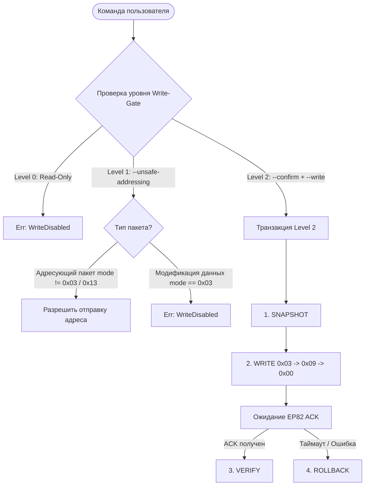

# ADR-001: Трёхуровневый Write-Gate и протокол аппаратной безопасности конфигурации мыши PANTEON MS89

- **Статус:** Принято (Accepted)
- **Дата:** 2026-11-09
- **Авторы:** PanteonConfig contributors
- **Область:** `panteon-ms89` (core, device, transport, CLI)
- **Ревизия:** 2026-11-24 — состав флагов Level 2 приведён в соответствие с действующим CLI (`--confirm --write`); бланкетный флаг обхода удалён в 0.1.1. Логика гейта и транзакций не менялась.

---

## 1. Контекст и проблематика (Context)

Проект `panteon-ms89` является независимой реализацией, построенной по наблюдаемому протоколу, для конфигурирования игровой мыши PANTEON MS89 (USB VID `0x30fa`, PID `0x1440`).

Анализ 13 USBPcap-трасс (`mouse_packets.pcapng`, `ctrl_a_open.pcapng` .. `ctrl_m_poll_125.pcapng`) выявил следующие физические характеристики контроллера:
1. **Протокол записи:**
   - 8-байтные feature-отчёты HID (Report ID `0x07`): `07 18 <mode> <bank> <addr_lo> <addr_hi> <data_lo> <data_hi>`.
   - Режимы `mode`: `0x03` (запись регистра в банк), `0x09` (коммит банка), `0x00` (финальный коммит).
   - После каждого финального коммита контроллер возвращает 8-байтный пакет на Endpoint 0x82 (Interrupt IN): `03 00 00 00 00 00 00 00` (1440 раз зафиксировано в трассах).
   - **Физический размер дескриптора:** Дескриптор Interface 1 объявляет для Report ID 0x07 `Report Count = 7`, `Report Size = 8` (7 байт полезной нагрузки + 1 байт Report ID = ровно 8 байт буфера). Использование 9 байт вызывало STALL из-за `wLength = 9`.
2. **Протокол чтения:**
   - Полное вычитывание регистров памяти на шине USB **не наблюдается** (GUI хранит конфигурацию локально на ПК и пушит 867 пакетов).
   - Единственный подтверждённый кадр чтения с устройства — 8-байтный handshake `GET_REPORT` Feature 0x07 (`07 00 76 09 <rev> 00 <status> <flags>`), семантика `status/flags` которого не подтверждена для произвольных слотов.
   - Предполагаемый протокол чтения произвольных регистров требует предварительной записи на шину (адресация/read-request перед `GET_REPORT`).
3. **Риски повреждения оборудования:**
   - Неконтролируемая запись в контроллер мыши (Flash/EEPROM/SRAM) несёт прямой риск повреждения таблицы калибровок сенсора, сбоя контроллера подсветки или необратимого окирпичивания (brick) устройства.
   - Любая трансляция случайных или недоказанных байтов в сторону мыши должна быть программно и аппаратно предотвращена.

---

## 2. Принятое решение (Decision)

Вводится строгая трёхуровневая иерархическая система защиты от записи (**Three-Level Write-Gate**), управляемая через конфигурацию транспорта и явные CLI-флаги.

### 2.1. Уровни доступа (Gate Levels)

- **Level 0 (По умолчанию — Read-Only):**
  - Никакие операции записи в HID-устройство не допускаются.
  - Любой вызов `Transport::write_feature` безусловно возвращает `Err(PanteonError::WriteDisabled)`.
  - Все CLI-команды работают исключительно на чтение либо в режиме симуляции (Dry-Run).
- **Level 1 (`--unsafe-addressing` — Только адресация):**
  - Разрешена отправка **ТОЛЬКО** гипотетических адресующих пакетов (read-request/probe), не содержащих модификации пользовательских данных (например, `mode != 0x03`, либо команда `0x13`).
  - Любые пакеты модификации регистров (`mode == 0x03`) блокируются с `Err(PanteonError::WriteDisabled)`.
  - Уровень предназначен исключительно для экспериментального зондирования протокола чтения без риска изменения настроек устройства.
- **Level 2 (`--confirm` И `--write` — Полная запись):**
  - Разрешена модификация конфигурационных регистров мыши.
  - Требует одновременной передачи **обоих** защитных флагов безопасности.
  - Каждая операция записи обязана выполняться строго через транзакционный протокол (см. раздел 2.2).

### 2.2. Протокол транзакции Level 2 (`WriteTransaction`)

Любое изменение состояния устройства (например, смена частоты опроса `POLLING_RATE` или DPI) оформляется как атомарная многофазная транзакция, обязательно предваряемая аппаратной преамбулой разблокировки.

#### Структура транзакции:

1. **ФАЗА 0: ПРЕАМБУЛА РАЗБЛОКИРОВКИ (Preamble / CONFIG_UNLOCK)**
   - Каждая сессия записи обязана открываться мини-транзакцией инициализации/разблокировки (3 кадра):
     - `P1 (Data Write)`: `07 18 03 00 01 00 03 00` (Bank 0, Addr `0x0001`, Data `0x0003`)
     - `P2 (Commit Bank)`: `07 18 09 00 01 00 00 00` (Commit Bank 0 для адреса `0x0001`)
     - `P3 (Final Commit)`: `07 18 00 00 01 00 00 00` (Final Commit для адреса `0x0001`)
   - **Evidence (Доказательная база):**
     - Присутствует в 100% дампов USB-трафика (все 13 дампов `ctrl_a_open` .. `ctrl_m_poll_125`, кадры #22, #24, #26 в `ctrl_a_open` и `mouse_packets.pcapng`).
     - **Аппаратное поведение без преамбулы:** Попытка прямой записи регистров конфигурации без предварительной преамбулы вызывает аппаратный отказ контроллера (**STALL**, в Linux проявляется как `os error 71 / EPROTO` и инициирует сброс шины USB в `dmesg`).
   - **Ограничения уровней:** Преамбула разблокировки разрешена **только на Level 2**. На Level 1 отправка преамбулы запрещена (так как это запись в регистр `0x0001`).

2. **ФАЗА 1: СНАПШОТ (Snapshot)**
   - Выполняется попытка зафиксировать текущее состояние затрагиваемых регистров `(bank, addr)`.
   - Если чтение недоступно (аппаратный протокол чтения не подтверждён), транзакция использует известное предыдущее значение (`initial_data`), либо фиксирует статус `unverified`.

3. **ФАЗА 2: ОСНОВНАЯ ЗАПИСЬ (Main Configuration Write)**
   - Передача последовательности основных 8-байтных кадров `07 18`:
     1. Кадр данных: `07 18 03 <bank> <addrLE16> <dataLE16>` (`mode = 0x03`)
     2. Кадр коммита банка: `07 18 09 00 <addrLE16> <dataLE16>` (`mode = 0x09`)
     3. Кадр финального коммита: `07 18 00 00 <addrLE16> 00 00` (`mode = 0x00`)
   - **Правило адресации коммитов:** Кадры коммита (`0x09` и `0x00`) несут `addr` последней записанной `data`-записи блока.
   - Ожидание аппаратного подтверждения: приём пакета `03 00 00 00 00 00 00 00` с Endpoint `0x82` (Interrupt IN) с таймаутом (500 мс).

4. **ФАЗА 3: ВЕРИФИКАЦИЯ (Verification)**
   - **Статус `unverified`:** Ввиду отсутствия на шине USB протокола прямого вычитывания регистров памяти без предварительной записи, после успешного завершения write-транзакции и получения EP82 ACK состояние помечается статусом `unverified`.
   - **GUI-дисплей НЕ является оракулом:** Отображение параметров в официальном софте не может служить подтверждением записи, так как софт хранит настройки локально на ПК и слепо перезаписывает память мыши 867 пакетами `SET_REPORT` при открытии.
   - **Физическая верификация:** Объективное подтверждение применения настроек осуществляется внешним хронометражем пакетов отчётов перемещения на Endpoint `0x81` (Interrupt IN) через ядро Linux `usbmon`:
     - Частота 500 Гц: median интервала пакетов составляет `1.996 ms`.
     - Частота 1000 Гц: median интервала пакетов составляет `0.996 ms`.
   - **Отложенное применение (Deferred Apply):** Конфигурация сохраняется в энергонезависимой памяти контроллера и активируется при повторном перечислении устройства (re-enumeration / replug мыши).
   - Подробная методология и awk-пайплайн live-замера описаны в разделе «Live write verification» внутренней технической документации.

5. **ФАЗА 4: ОТКАТ (Rollback)**
   - Если преамбула прошла успешно, а отправка основного блока конфигурации завершилась ошибкой (или таймаутом ACK):
     - Выполняется процедура отката (`rollback`) основной части транзакции, возвращающая регистры к значениям из `initial_data`.
     - При необходимости выполняется повторный unlock преамбулы.

### 2.2.1. Пофазовая диагностика и инструментарий локализации (Per-Frame Diagnostics)

Для локализации аппаратных сбоев микроконтроллера реализована система детальной инструментации:
1. **Именование фаз транзакции в ошибках:**
   - Каждый кадр исполняется с отслеживанием фазы:
     - `P1`: Preamble Data Write (`07 18 03 00 01 00 03 00`)
     - `P2`: Preamble Commit Bank (`07 18 09 00 01 00 00 00`)
     - `P3`: Preamble Final Commit (`07 18 00 00 01 00 00 00`)
     - `W1`: Main Data Write (например, `07 18 03 06 18 00 00 07`)
     - `W2`: Main Commit Bank (`07 18 09 00 18 00 00 07`)
     - `W3`: Main Final Commit (`07 18 00 00 18 00 00 00`)
   - При отказе конкретного кадра возвращается точная ошибка `PanteonError::Io("frame <NAME> failed: <ERR>")`, отображающая сбойную фазу в CLI.
2. **Паузы стабилизации (`--settle-ms <N>`):**
   - Флаг `--settle-ms` задаёт задержку между кадрами (в миллисекундах) для учёта времени аппаратной записи во флеш/EEPROM микроконтроллера.
3. **Предварительный handshake (`--get-first`):**
   - Опция `--get-first` отправляет запрос `GET_REPORT` handshake перед отправкой преамбулы, зеркально воспроизводя последовательность официального GUI из трассы (GET #20 перед SET #22).
4. **Инструмент изоляции кадров (`raw-frame`):**
   - CLI-команда `raw-frame <HEX>` позволяет отправлять строго одиночный 8-байтный кадр в устройство под контролем Level 2 (`--confirm --write`) для пошаговой бисекции аппаратного отклика контроллера.

### 2.3. Маршрутизация по интерфейсам USB и дескриптор отчётов (HID Report Descriptor)

На физическом уровне устройство PANTEON MS89 представляет собой составное (composite) USB HID-устройство с двумя интерфейсами:
1. **Interface 0 (`wIndex = 0x0000`):** Стандартный интерфейс указателя/мыши (Boot Mouse, стандартные отчёты перемещения и кнопок на Endpoint `0x81`). Report ID 7 на нём не объявлен.
2. **Interface 1 (`wIndex = 0x0001`):** Служебный интерфейс вендор-специфичной конфигурации:
   - Все запросы чтения и записи конфигурации обязаны адресоваться к **Interface 1** (`bmRequestType = 0x21`, `wValue = 0x0307`, `wIndex = 0x0001`).
   - В ОС Linux этому интерфейсу соответствует отдельный символьный узел `/dev/hidrawN` (свойство `bInterfaceNumber = 1` в sysfs).
   - Попытка записи feature-отчёта `07 18 ...` в узел `hidraw`, привязанный к Interface 0, немедленно возвращает ошибку протокола (**STALL / os error 71**).
   - При этом пассивный запрос `GET_REPORT` handshake отвечает как с Interface 1, так и с Interface 0.
   - Пользовательский конфигуратор обязан автоматически фильтровать узлы `/sys/class/hidraw` и выбирать узел с `bInterfaceNumber == 1` для всех операций записи.
### 2.3.1. Report size (Аппаратный размер Feature Report и опровержение гипотезы 9 байт)

- **Физический формат на шине (Wire format):** Ровно **8 байт** (`[ID=07] + 7 байт данных = 8 байт всего`).
- **Первоисточник истины:** HID Report Descriptor узла Interface 1 (`/sys/class/hidraw/hidraw8/device/report_descriptor`):
  - `Usage Page (Vendor Defined 0xff01)`: `06 01 ff`
  - `Usage (0x01)`: `09 01`
  - `Collection (Application)`: `a1 01`
  - `Report ID (7)`: `85 07`
  - `Logical Minimum (0)`, `Logical Maximum (255)`: `15 00 26 ff 00`
  - `Usage (0x20)`: `09 20`
  - `Report Count (7)`: `95 07` (7 x 8-бит байт полезных данных)
  - `Report Size (8)`: `75 08`
  - `Feature (Data, Var, Abs)`: `b1 02`
- **Опровержение прежней гипотезы:**
  - Прежняя гипотеза «9 байт с pad-байтом `0x00`» **полностью опровергнута** дескриптором и живыми тестами на оборудовании.
  - При вызове `HIDIOCSFEATURE(9)` ядро Linux транслировало USB Control Transfer с `wLength = 9`. Микроконтроллер мыши строго проверяет `wLength` на соответствие дескриптору (`wLength == 8`) и возвращал аппаратный отказ **STALL** (`os error 71 / EPROTO`), вызывая сброс порта USB.
  - Примечание по асимметрии: запрос `GET_REPORT` прощал передачу большего буфера со стороны хоста (принимая до 9 байт), но `SET_REPORT` жёстко отвергал несовпадение размера.
- **Стандартизация:** Константа `FEATURE_REPORT_LEN` установлена в `8`. Все буферы, сигнатуры методов `write_feature`/`read_feature`, упаковщики `pack`/`unpack`, структуры транзакций и вызовы `HIDIOCSFEATURE_8` (`0xC0084806`) / `HIDIOCGFEATURE_8` (`0xC0084807`) приведены к 8 байтам.

### 2.4. Абсолютные запреты (Prohibitions на всех уровнях)

Даже при активном Level 2 **категорически запрещены**:
1. Команды обновления прошивки (команды загрузчика `0x10` и низкоуровневого bootloader).
2. Стирание банков памяти (`bank erase`).
3. Массовая перезапись неидентифицированных регистров памяти вне реестра `registers` без специального режима отладки.

---

## 3. Последствия (Consequences)

### Положительные:
- Полное исключение случайного окирпичивания мыши при использовании CLI и тестов.
- Предсказуемое и детерминированное поведение: режим Dry-Run по умолчанию наглядно показывает, какие именно байты были бы отправлены.
- Безопасная и предсказуемая работа с оборудованием.

### Отрицательные и компромиссы:
- Для применения настроек пользователю требуется явно указывать два подтверждающих флага безопасности.
- Чтение полного состояния реестра требует реализации безопасного зондирования адресации (Level 1).
