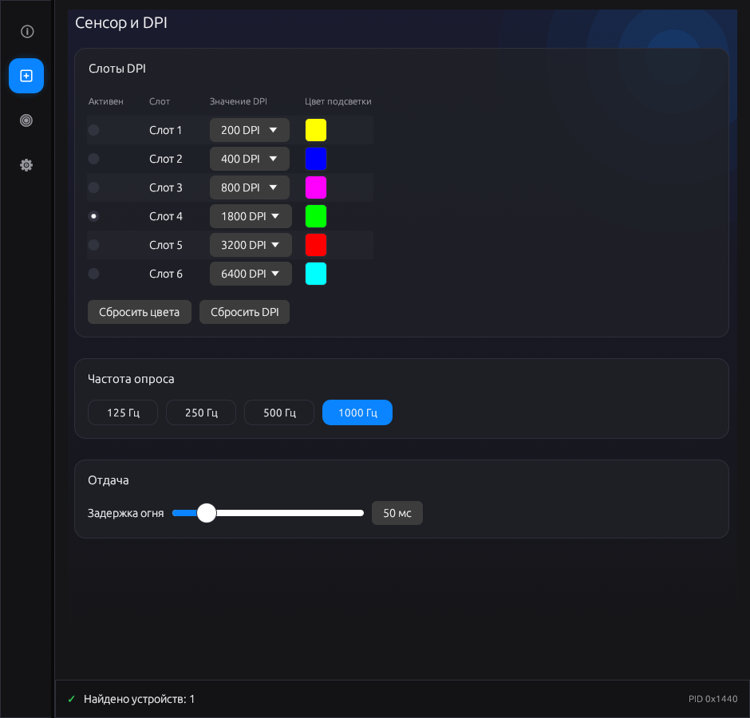

# PanteonConfig — конфигуратор мыши PANTEON MS89 для Linux

Неофициальный проект сообщества; не связан с производителем. Лицензия MIT, ПО
предоставляется «как есть» — см. [LICENSE](../LICENSE).



## Возможности

- **6 DPI-слотов** с дискретными шагами 200–12800 DPI и отдельным цветом подсветки.
- **Частота опроса** 125 / 250 / 500 / 1000 Гц с автоматическим USB soft-reset.
- **Подсветка:** 14 эффектов, палитра из 7 цветов, яркость.
- **Задержка кнопки «огонь»** 8–300 мс.
- **Профили TOML:** экспорт, импорт и готовые пресеты.
- **Снимки состояния:** импорт USB-трейсов и побайтовое воспроизведение.
- **GUI и CLI:** `panteon-gui` для повседневной настройки, `panteon-ms89` для скриптов.

## Установка (AppImage)

1. Скачайте `PanteonConfig-0.1.2-x86_64.AppImage` из
   [Releases](https://github.com/untopiad/pantconfig-ms89/releases) и сделайте исполняемым:

   ```bash
   chmod +x PanteonConfig-0.1.2-x86_64.AppImage
   ```

2. Установите udev-правило **один раз** (без него устройство не видно):

   ```bash
   curl -fsSL https://raw.githubusercontent.com/untopiad/pantconfig-ms89/v0.1.2/panteon-ms89/udev/99-panteon-ms89.rules \
     | sudo tee /etc/udev/rules.d/99-panteon-ms89.rules
   sudo udevadm control --reload-rules && sudo udevadm trigger --subsystem-match=hidraw --subsystem-match=usb
   ```

   Офлайн-вариант: правило уже внутри AppImage. Запустите `check-access` — при
   отсутствии правила он напечатает готовую команду установки; то же умеет GUI.

3. Запуск:

   ```bash
   ./PanteonConfig-0.1.2-x86_64.AppImage            # GUI
   ./PanteonConfig-0.1.2-x86_64.AppImage --help     # CLI
   ./PanteonConfig-0.1.2-x86_64.AppImage check-access
   ```

`check-access` — диагностика доступа: проверяет правило и права на hidraw и
USB-reset, возвращает 0 при готовности и 1 с причиной и командой установки.

## Использование

**Запись по умолчанию — план (dry-run):** команда печатает кадры, но ничего не
пишет. Применение — явные флаги `--confirm --write`.

```bash
panteon-ms89 list-devices                  # найти мышь
panteon-ms89 probe --read                  # прочитать handshake
panteon-ms89 dump-state                    # состояние (ledger + дескриптор)
panteon-ms89 set-polling 500               # план смены частоты
panteon-ms89 set-polling 500 --confirm --write
panteon-ms89 set-dpi-slots 400 800 1600 2400 3200 6400 --confirm --write
panteon-ms89 set-led --effect 5 --speed 2  # план эффекта подсветки
panteon-ms89 export -o profile.toml        # сохранить профиль
panteon-ms89 import profile.toml           # загрузить профиль
panteon-ms89 check-access                  # диагностика доступа
```

Для записи во flash (энергонезависимая память) добавьте `--commit-flash`; в GUI
это отдельное действие «Apply All».

## Безопасность

- **Dry-run по умолчанию:** без `--confirm --write` команда только показывает план.
- **Подтверждение записи:** каждый запуск с записью требует обоих флагов; GUI
  показывает диалог с превью кадров.
- **Flash — только явно:** запись в энергонезависимую память включается отдельным
  `--commit-flash` (GUI: «Apply All»).
- **Непроверенные устройства заблокированы:** пока протокол не подтверждён,
  запись запрещена; исключение — явный escape
  `--allow-unverified-device --confirm --write`.

## Ограничения

- Произвольное чтение регистров невозможно: прошивка отдаёт только 32-байтовую
  дескрипторную страницу. Состояние восстанавливается из теневого журнала и снимков.
- Новая частота опроса применяется после ре-энумерации USB; soft-reset выполняется
  автоматически.

## Документация

- [FAQ](../docs/faq.md)
- [ADR-001: Write-Gate](../docs/adr/ADR-001-write-gate.md)
- [ADR-002: нет readback](../docs/adr/ADR-002-no-register-readback.md)
- [ADR-003: цвета DPI-слотов](../docs/adr/ADR-003-dpi-slot-colors-two-state-nibble.md)
- [Скриншоты](../docs/screenshots)

## Поддержать проект

Проект бесплатный и открытый (MIT), без телеметрии и рекламы. Проверка протокола
идёт на реальном железе: каждая новая ревизия мыши — это покупка устройства
и часы живых тестов.

- [Boosty](https://boosty.to/untopiad/donate) — разово или подписка;
- USDC (сеть Base): `0x3bc688227cC6C0ffA9Dbd18c6361beDC975d456F`

Ещё ценнее — отчёт о совместимости вашей ревизии MS89 в issues: это напрямую
расширяет список проверенных устройств.